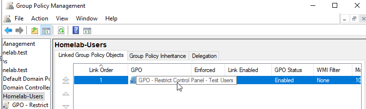
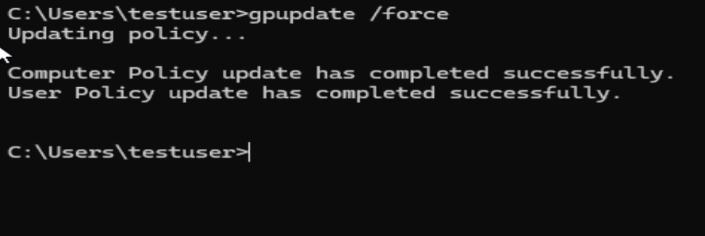
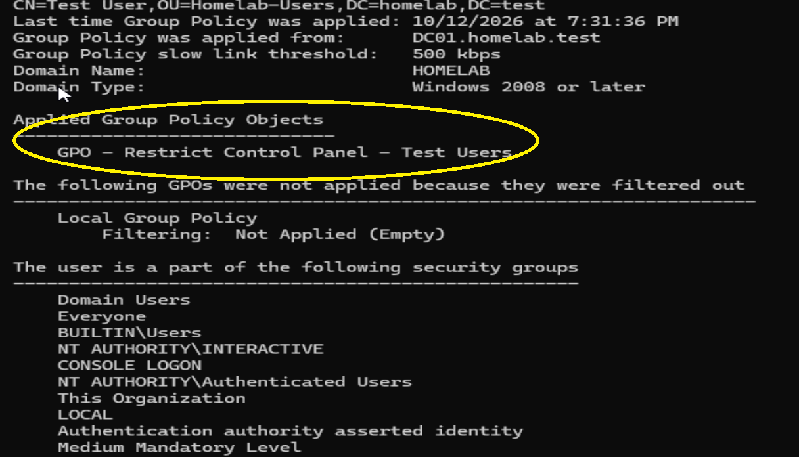
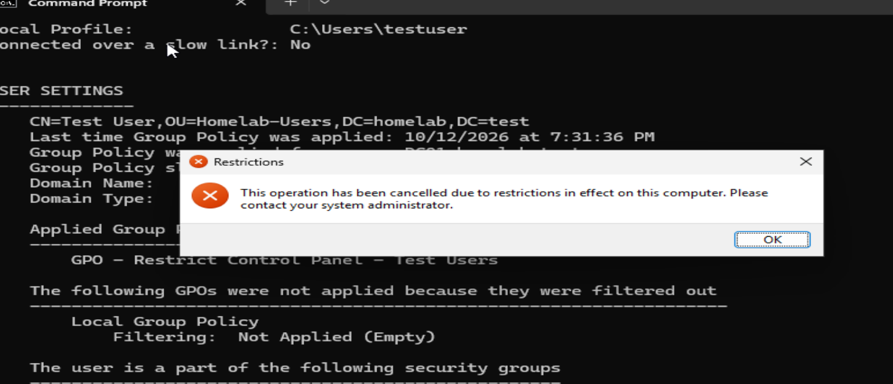

# windows-server-group-policy-homelab
Windows Server 2022 Group Policy homelab demonstrating centralized policy management, troubleshooting, and verification with Windows 11.
# Windows Server 2022 Group Policy Homelab

## Project Overview

This project demonstrates my hands-on experience configuring and troubleshooting Group Policy in a Windows Active Directory environment using Oracle VirtualBox.

**Objective:** Create a Group Policy Object (GPO) that restricts Control Panel access for a domain user, deploy the policy to Windows 11, and verify successful enforcement.

## Lab Environment

| Component | Configuration |
|---|---|
| Hypervisor | Oracle VirtualBox |
| Domain Controller | Windows Server 2022 (DC01) |
| Client Computer | Windows 11 Pro (CLIENT01) |
| Active Directory Domain | homelab.test |
| Domain Controller IP | 192.168.10.1 |
| Client IP | 192.168.10.10 |
| Organizational Unit | Homelab-Users |
| Test Account | HOMELAB\testuser |

## Step 1: Create and Link a Group Policy Object

On DC01, I opened Group Policy Management and created a GPO named:

`GPO - Restrict Control Panel - Test Users`

I linked the GPO to the **Homelab-Users** organizational unit, which contains my test user account.

## Step 2: Configure the Control Panel Restriction

In Group Policy Management Editor, I navigated to:

**User Configuration → Policies → Administrative Templates → Control Panel**

I configured the following policy:

**Prohibit access to Control Panel and PC settings: Enabled**

This policy prevents affected users from opening Control Panel and Windows Settings.

## Step 3: Update Group Policy on CLIENT01

After configuring the policy, I opened Command Prompt on CLIENT01 and ran:

`gpupdate /force`

Both computer and user policy updates completed successfully.

## Step 4: Verify the Applied GPO

I ran:

`gpresult /r`

Under **USER SETTINGS → Applied Group Policy Objects**, the output confirmed that the Control Panel restriction GPO was applied to the domain test user.

## Step 5: Test Control Panel Access

While signed in as `HOMELAB\testuser`, I attempted to open Control Panel.

Windows displayed a restriction message, confirming that the policy was successfully enforced.

## Troubleshooting Experience

During initial testing, Control Panel remained accessible even after running `gpupdate /force`.

**Problem:** The GPO was created and linked, but the actual restriction setting remained **Not Configured**.

**Resolution:**

1. Opened Group Policy Management Editor on DC01.
2. Located the Control Panel restriction setting.
3. Changed the setting from **Not Configured** to **Enabled**.
4. Ran `gpupdate /force` on CLIENT01.
5. Signed out and back into the domain user account.
6. Verified the applied GPO using `gpresult /r`.
7. Confirmed that Control Panel access was blocked.

## Skills Demonstrated

- Windows Server 2022 administration
- Active Directory Group Policy management
- Organizational Unit management
- Creating and linking Group Policy Objects
- Configuring user-based security restrictions
- Troubleshooting policy application
- Using `gpupdate /force` and `gpresult /r`
- Windows 11 domain administration

## Lessons Learned

Creating and linking a Group Policy Object does not automatically enforce a restriction. The individual policy setting must be correctly configured.

I also learned that `gpupdate /force` confirms a policy refresh, while `gpresult /r` helps verify which GPOs were applied.

## Future Improvements

- Configure password and account lockout policies
- Practice Group Policy security filtering
- Explore Group Policy inheritance
- Configure mapped network drives through Group Policy Preferences

---

*This project was completed in a virtual lab environment for practical IT support and Windows administration training.*
